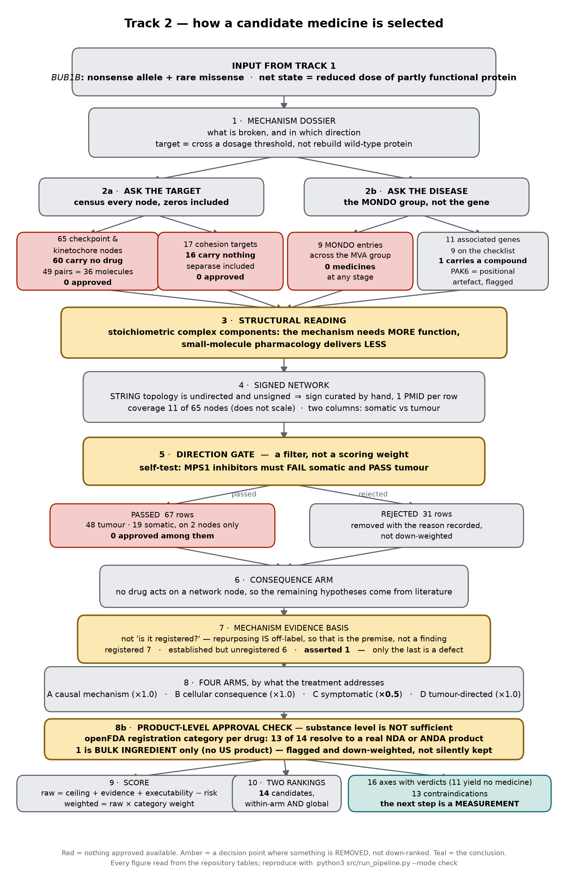

# Track 2 - drug repurposing

Track 2 of the MVA Hackathon 2026: **drug repurposing** for a child with BUB1B-related
mosaic variegated aneuploidy.

This directory sits inside the `rare-disease-bebok` repository, alongside Track 1 - the
variant identification that produced the mechanism this work starts from. Track 1 answers
*which variant*; Track 2 takes that mechanism as input and asks a different question:
*does an existing medicine act on this biology?*

Everything here is a **hypothesis for expert follow-up, not evidence that a medicine works.**

## What is in this directory

| path | what is in it |
| --- | --- |
| `bebok_track2_report.md` | the submitted report - the only document that needs reading |
| `src/` | 10 standard-library scripts, one per pipeline stage, plus `run_pipeline.py`, which re-runs them and diffs the result against what is committed |
| `config/` | 4 hand-curated inputs: the two node sets, the MVA gene checklist, the action-type effects |
| `data/` | 18 tables: the machine-regenerated census and gate output, the hand-signed network, and the verdict on all 16 therapeutic axes |
| `results/` | the ranked shortlist, the validation plan, the expression evidence |
| `docs/` | the method figure |

The Track 1 input to this work is
[`../submission/track_1/bebok_track1_report.md`](../submission/track_1/bebok_track1_report.md).
Run anything here from this directory: the scripts resolve their own location, so
`python3 src/run_pipeline.py --mode check` works from `track2/` regardless of where the
repository is checked out.

## How the method runs

```mermaid
flowchart TD
    V["<b>Input from Track 1</b><br/>BUB1B: nonsense allele + rare missense<br/>net state = reduced dose of partly functional protein"]

    V --> M["<b>1. Mechanism dossier</b><br/>what is broken, and in which direction<br/>target = cross a dosage threshold, not rebuild wild-type"]

    M --> T["<b>2a. Ask the TARGET</b><br/>census every node, zeros included"]
    M --> D["<b>2b. Ask the DISEASE</b><br/>MONDO group, not the gene"]

    T --> T1["65 SAC/kinetochore nodes<br/><b>60 carry no drug at all</b><br/>49 node-compound pairs = 36 molecules<br/><b>0 approved</b>"]
    T --> T2["17 cohesion targets<br/><b>16 carry no compound at all</b><br/>separase included<br/><b>0 approved</b>"]
    D --> D1["9 MONDO entries across the MVA group<br/><b>0 medicines at any clinical stage</b>"]
    D --> D2["11 associated genes above threshold<br/>9 on the curated checklist<br/><b>1 carries any compound</b><br/>PAK6 flagged: positional artefact"]

    T1 --> S{"<b>3. Structural reading</b><br/>stoichiometric complex components<br/>mechanism needs MORE function<br/>chemistry delivers LESS"}
    T2 --> S
    D1 --> S
    D2 --> S

    S --> N["<b>4. Signed network</b><br/>STRING topology is undirected and unsigned<br/>sign curated by hand, 1 PMID per row<br/>coverage 11 of 65 - does not scale<br/>two columns: somatic vs tumour"]

    N --> G{"<b>5. Direction GATE</b><br/>a filter, not a scoring weight<br/>self-test: MPS1 must fail somatic, pass tumour"}

    G -->|"passed 67 rows<br/>48 tumour, 19 somatic"| GP["<b>0 approved among the passes</b><br/>19 somatic passes on 2 nodes only"]
    G -->|"rejected 31 rows"| GR["removed with the reason recorded<br/>not down-weighted"]

    GP --> L["<b>6. Consequence arm</b><br/>no drug acts on a network node,<br/>so hypotheses come from literature"]
    GR --> L

    L --> VER{"<b>7. Mechanism evidence basis</b><br/>registered / established but unregistered / asserted<br/><i>mismatch is not a defect - repurposing IS off-label</i>"}
    VER -->|"registered 7 &middot; established 6<br/>both legitimate for repurposing"| ARMS
    VER -->|"asserted 1, kept with a caution flag<br/>2 others removed outright"| ARMS
    ARMS["<b>8. Four arms, by what the treatment addresses</b>"]
    ARMS --> A["<b>A. causal mechanism</b><br/>BUBR1 dose &middot; weight x1.0"]
    ARMS --> B["<b>B. cellular consequence</b><br/>weight x1.0"]
    ARMS --> C["<b>C. symptomatic</b><br/>one row per feature &middot; <b>weight x0.5</b>"]
    ARMS --> E["<b>D. tumour-directed</b><br/>direction inverts &middot; weight x1.0"]

    A --> FDA["<b>8b. Product-level approval check</b><br/>openFDA registration category per drug<br/>substance level is NOT sufficient<br/><b>13 of 14 resolve to an NDA or ANDA</b><br/>1 is BULK INGREDIENT only - flagged, not deleted"]
    B --> FDA
    C --> FDA
    E --> FDA

    FDA --> SC["<b>9. Score</b><br/>raw = ceiling + evidence + executability - risk<br/>weighted = raw x category weight<br/><i>ordering weights, not probabilities</i>"]

    SC --> R["<b>10. Two rankings</b><br/>14 candidates<br/>within-arm AND global<br/>every row carries its own counter-evidence"]

    R --> OUT1["<b>16 axes considered</b><br/>with verdicts, including<br/>the 11 that yield no medicine"]
    R --> OUT2["<b>13 contraindications</b><br/>with the triggering feature"]
    R --> OUT3["<b>Verdict:</b> the highest-value<br/>next step is a <b>measurement</b>,<br/>not a medicine"]

    style S fill:#fff3cd,stroke:#856404,stroke-width:2px
    style G fill:#fff3cd,stroke:#856404,stroke-width:2px
    style VER fill:#fff3cd,stroke:#856404,stroke-width:2px
    style FDA fill:#fff3cd,stroke:#856404,stroke-width:2px
    style OUT3 fill:#d4edda,stroke:#155724,stroke-width:2px
    style T1 fill:#f8d7da,stroke:#721c24
    style T2 fill:#f8d7da,stroke:#721c24
    style D1 fill:#f8d7da,stroke:#721c24
```

*The same schematic as a figure, for slides and print:* [`docs/track2_flow.png`](docs/track2_flow.png)

Reading the diagram: the two red paths are the **negative result** - asked of the target and
asked of the disease, nothing approved comes back. The three amber diamonds are the decision
points where something is removed rather than down-ranked. The green box is the conclusion.

Stage numbers map to sections 3 to 6e of the report, which carry the same figures in prose with
the full candidate table and the verdict on every axis examined.

## Read in this order

| file | what it is |
| --- | --- |
| [bebok_track2_report.md](bebok_track2_report.md) | **the submitted report**, and the only document that needs reading - mechanism, the negative result, the candidate arms, what must not be given, how it was produced, and the organisers' methods form as Appendix A |
| [results/validation_plan.md](results/validation_plan.md) | what experiment would refute each shortlisted hypothesis |
| [results/expression_evidence.md](results/expression_evidence.md) | public cell and animal data, including a result retracted on inspection |
| [results/ranked_candidates.tsv](results/ranked_candidates.tsv) | the shortlist, scoring components shown beside the total |
| [data/axes_considered.tsv](data/axes_considered.tsv) | every therapeutic axis examined, with its verdict and reason |

The report is self-contained: environment and data sources, the boundary between what a script
regenerates and what was a human judgement, the corrections made during the work, and what this
repository cannot show are section 10 and Appendix A.

## The headline results

**No approved medicine acts on any node of the machinery this disease breaks.** Of 65
spindle-checkpoint and kinetochore nodes, 60 carry no drug of any kind; the five exceptions
hold 49 compounds, none approved and none restorative: 47 are inhibitors, one is an antisense
inhibitor and one is a peptide vaccine antigen. The cohesion layer - checked separately
because premature chromatid separation is the cytogenetic hallmark - returns 17 targets, 16
with no compound at all, including separase.

**The reason is structural, not accidental.** These are stoichiometric components of a
complex: the mechanism needs *more* function and small-molecule pharmacology delivers *less*.
That generalises beyond this disease.

**Required direction of action is tissue-dependent.** Somatic tissue needs segregation
fidelity restored; the tumour needs pushing past the tolerable threshold. The same drug can
be contraindicated systemically and rational against the sarcoma, so candidates split into
two non-overlapping arms.

**Database verification sorts mechanistic claims by where their evidence sits - it does not treat a mismatch as a defect.** Proposing a drug for a disease it is not registered for IS repurposing; that is the point of the exercise, not a finding. What is worth separating is the basis of the *mechanistic* claim, and the candidates fall into three groups rather than two: the registered mechanism IS the lever invoked (7 of 14); the activity is established pharmacology but not the registered mechanism (6 of 14 - phenylbutyrate's chaperone activity, hydroxychloroquine's blockade of autophagic flux); or the activity is *asserted* from inference rather than established for that drug (1 of 14, metformin). Only the third group is a problem, and it is the group this check exists to catch: it is what removed fingolimod and perphenazine, both proposed as PP2A activators on review-literature grounds that neither drug's established pharmacology supports. The per-candidate basis is recorded in `mechanism_evidence_basis`.

**Approval had to be checked twice, and the two levels disagree.** A target database reports
approval for a *substance*, jurisdiction-agnostically; that is not evidence an approved
*product* exists. Checking each candidate against openFDA's registration category, 13 of 14
resolve to a real NDA or ANDA. The disagreements run both ways: the top-ranked candidate,
**arimoclomol**, is recorded at PHASE_3 in the target database but returns an FDA NDA directly
(approved September 2024, in combination with miglustat, from 2 years of age) - a release lag,
not a dispute. **Ataluren** moves the other way: one openFDA record, `BULK INGREDIENT`, so no US
product at all, with an EU conditional authorisation reportedly not renewed in March 2025. It is
flagged and down-weighted rather than deleted, because EU status needs checking, not assuming.

## Two rules this repository is built around

1. **No drug name enters an output from memory.** Every candidate carries a ChEMBL identifier
   and, where a mechanism is claimed, a PMID verified through NCBI E-utilities.
2. **Only medicines already in human use qualify.** Experimental compounds are kept in a
   separate column as mechanistic context, never presented as candidates. Approval in **any one
   jurisdiction, for any indication** is enough - repurposing needs a known safety profile and an
   existing supply chain, not a matching label - but it is verified at product level, not just
   substance level.

## Data provenance

Open Targets (drug-target associations, mechanism action types, clinical stage, variant
effect predictions), ChEMBL, STRING (network topology - unsigned and undirected; the sign in
`data/signed_network.tsv` is curated by hand with one citation per row), UniProt O60566
(domain boundaries), **ChEMBL mechanism endpoint** (queried directly, because Open Targets does not
mirror it completely), **openFDA** (`/drug/ndc` and `/drug/label` - US product registration
category, marketing start date and verbatim label indication), NCBI E-utilities (PubMed,
ClinVar) and GEO (GSE86928, GSE134781).
